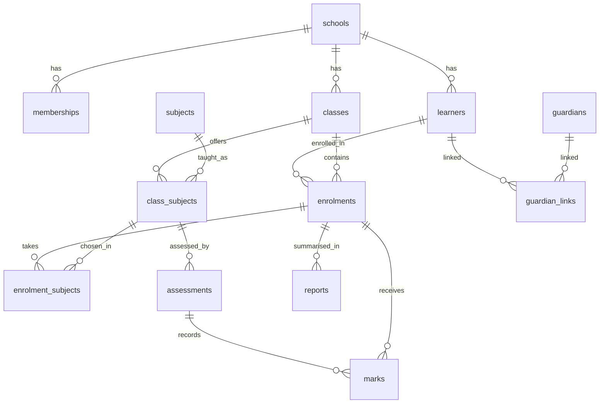
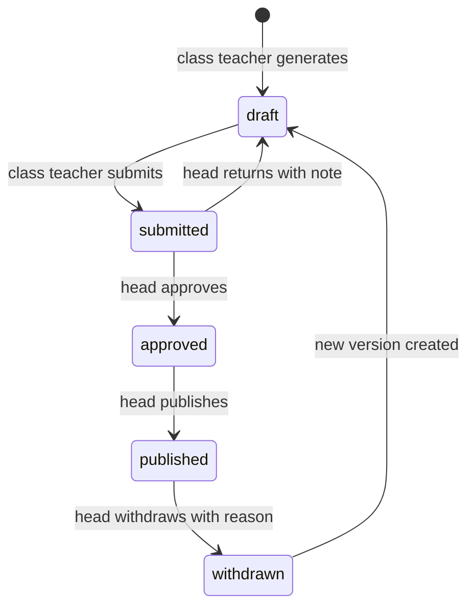

# SP Portal: Data Model

Status: DRAFT v0.1. Postgres on Supabase. Companion to `SPEC.md`. Column names match the CSV files in `seed/`.

## 1. Conventions

- Primary keys are `uuid` (`gen_random_uuid()`). Timestamps are `timestamptz` in UTC; display in `Africa/Harare`.
- **Every tenant table has `school_id uuid not null references schools(id)`**, indexed, and row-level security enabled. Exceptions: `schools` (its own `id` is the tenant), `profiles` and `platform_admins` (global, described below), and `sign_in_attempts` (global, service role only; see below).
- Child tables repeat `school_id` (even when it could be derived) so policies never need joins. A trigger or composite check ensures a child's `school_id` equals its parent's.
- Nothing personal is hard-deleted: learners, marks and reports use `status` fields. Deletion of a school is a super-admin operation done offline.
- `created_at` and `updated_at` on every table (`updated_at` set by trigger). Omitted below for brevity.
- Names are `snake_case`, plural tables, enums as Postgres enum types.

## 2. Overview



Reading it: a learner is enrolled in one class per year; each learner takes some of the class's subjects (`enrolment_subjects`); teachers set assessments per class subject; marks belong to an assessment and an enrolment; reports summarise an enrolment for a term.

## 3. Enums

| Enum                  | Values                                                                                     |
| --------------------- | ------------------------------------------------------------------------------------------ |
| `school_stage`        | primary, secondary, combined                                                               |
| `app_role`            | school_admin, head, hod, teacher, parent, learner (super admin lives in `platform_admins`) |
| `membership_status`   | invited, active, disabled                                                                  |
| `level_stage`         | ecd, primary, o_level, a_level                                                             |
| `term_kind`           | term, vacation, mock                                                                       |
| `term_status`         | planned, open, locked, closed                                                              |
| `assessment_type`     | test, assignment, exam, practical, vacation                                                |
| `mark_status`         | present, absent, excused                                                                   |
| `comment_status`      | draft, submitted                                                                           |
| `report_status`       | draft, submitted, approved, published, withdrawn                                           |
| `enrolment_status`    | enrolled, promoted, repeating, transferred, left, graduated                                |
| `audience_type`       | all, staff, learners, parents, class                                                       |
| `announcement_status` | draft, published, archived (D49)                                                           |
| `sex`                 | F, M (Q27)                                                                                 |
| `learner_status`      | active, left, graduated                                                                    |
| `import_kind`         | staff, learners, marks                                                                     |
| `import_status`       | validated, committed, failed                                                               |

## 4. Tables

### 4.1 Platform and tenancy

**schools**: the tenant.

```
id, slug unique, name, motto, stage school_stage, address, phone, email,
logo_path, stamp_path, head_signature_path,           -- Supabase Storage paths
primary_color, accent_color,                           -- hex, contrast-checked
report_footer_text, timezone default 'Africa/Harare',
feature_flags jsonb default '{}', status ('active'|'suspended')
```

**profiles**: one row per person, global (`id` = `auth.users.id`).

```
id pk fk auth.users, full_name, email, phone
```

Readable only by the person themselves and by users who share a school with them through `memberships`.

**platform_admins**: `user_id pk fk auth.users`. Super admins. No policy grants them tenant data by default (support access is a deliberate later feature).

**sign_in_attempts**: `id bigint identity pk`, `email_hash` (SHA-256 hex of the trimmed, lower-cased email), `succeeded bool`, `created_at`. Per-account sign-in lockout (US-1.1); wrong password-reset codes count too (US-1.7, D19). Learner PIN tries are counted here too, under a hash of the school and learner number (D26), and wrong PINs also under a hash of the school and network address (D28). Public report verification lookups are counted under a hash of the network address (D45). No `school_id`, because the school is unknown before sign in. RLS on with no policies and privileges revoked from `anon` and `authenticated`: only the service role reads or writes it.

**memberships**: a person's role in a school.

```
id, school_id, user_id fk profiles, role app_role, status membership_status
unique (school_id, user_id, role)
```

A person can have several rows (a teacher who is also a parent; a teacher in two schools).

**invites**: one-time parent codes (US-1.3, D25).

```
id, school_id, role app_role, email, phone, guardian_id null, learner_id null,
code_hash (SHA-256 hex, unique), expires_at, accepted_at null, accepted_by null, created_by, created_at
check: role = parent and guardian_id not null (staff use Auth invites, D14; learners get PINs, D26)
```

Written only by `create_parent_invite()` (school admin; 14 days; stops older waiting codes for the guardian) and `redeem_parent_invite()` (links the caller to the guardian and gives them an active parent membership). `parent_invite_preview()` tells anyone holding a code whether it is valid, used, expired or unknown. Read by school admin and head.

**import_jobs**

```
id, school_id, kind import_kind, status import_status,
file_path, error_report jsonb, created_by,
class_subject_id, term_id   -- marks uploads only (D33)
```

`file_path` is the stored upload in the `imports` bucket. `error_report` holds `{fileName, errors: [{row, message}], summary, committed, notInvited}` (D24). A job is `validated` (clean, waiting), `committed` (by `commit_learner_import()`, `commit_staff_import()` or `commit_marks_import()`, all or nothing) or `failed` (errors, nothing imported). A `marks` job names its class subject and term (both required for marks, null otherwise); its kind, class subject, term and author never change (D33).

### 4.2 Academic structure

**grade_levels**

```
id, school_id, name ('Form 4'), stage level_stage, sort_order, grading_scale_id fk
```

**academic_years**

```
id, school_id, label ('2026'), starts_on, ends_on, is_current, setup_completed_at (null while the setup wizard is in progress, D22)
unique (school_id, label); at most one is_current per school (set_current_academic_year()); finishing is refused while academic_year_setup_gaps() returns rows (D22)
```

**terms**: reporting periods.

```
id, school_id, academic_year_id, name, kind term_kind, starts_on, ends_on,
marks_deadline date, status term_status
```

**classes**

```
id, school_id, academic_year_id, grade_level_id, name ('4 Blue'),
class_teacher_id fk profiles
unique (academic_year_id, name)
```

**subjects**

```
id, school_id, code, name, stage_scope, is_core boolean, sort_order
unique (school_id, code)
```

**class_subjects**: a subject taught to a class, with its teacher.

```
id, school_id, class_id, subject_id, teacher_id fk profiles (null only while the year's setup is in progress, D22)
unique (class_id, subject_id); teacher and class teacher must be active teacher or hod (D20)
```

### 4.3 People in the school

**learners**

```
id, school_id, learner_number, first_name, last_name, date_of_birth, sex,
status learner_status ('active'|'left'|'graduated'), user_id null fk profiles, admission_date
unique (school_id, learner_number); never deleted (trigger), audited (D23)
user_id: the learner's own login (US-1.2), set only by link_learner_login() (D26)
```

**enrolments**: a learner in a class for a year.

```
id, school_id, learner_id, class_id, academic_year_id, status enrolment_status
unique (learner_id, academic_year_id); (class_id, academic_year_id) must be the class's own year (fk)
```

**enrolment_subjects**: the subjects an enrolled learner takes.

```
id, school_id, enrolment_id, class_subject_id
unique (enrolment_id, class_subject_id)
check: class_subject.class_id = enrolment.class_id (trigger; an enrolment cannot change class while it has choices in the old one)
```

**guardians**

```
id, school_id, full_name, phone, email, user_id null fk profiles
```

`user_id` is the parent login, set only by `redeem_parent_invite()` (D25). Neither `learners.user_id` nor `guardians.user_id` is writable through the Data API.

**guardian_links**

```
id, school_id, guardian_id, learner_id, relationship, is_primary
unique (guardian_id, learner_id); at most one is_primary per learner
```

One guardian linked to two learners is how siblings appear under one parent login.

### 4.4 Assessment

**grading_scales**: `id, school_id, name, stage level_stage, is_default`

**grading_bands**

```
id, school_id, scale_id, grade, min_mark int, max_mark int, remark, sort_order
check min_mark <= max_mark; a validation function proves a scale covers 0 to 100
with no gaps or overlaps before it can be set default
(grading_scale_problems, grading_scale_is_complete; D21). The band editor replaces a
scale's bands in one call, save_grading_bands() (D22).
```

**assessments**

```
id, school_id, term_id, class_subject_id, name, type assessment_type,
max_mark numeric, weight_percent numeric, sort_order, assessed_on, is_locked boolean
term and class subject in the same year; an assessment with marks cannot move, and max_mark cannot drop below an entered score
is_locked: set only by school admin or head; blocks teachers until the class subject is unlocked (D30)
```

`assessment_weights_are_complete(term, class_subject)` checks `sum(weight_percent) = 100`; `assessment_weight_problems(term)` lists the class subjects whose total is not 100 (D30). Report generation refuses otherwise.

**marks**

```
id, school_id, assessment_id, enrolment_id, score numeric null,
status mark_status, entered_by fk profiles
unique (assessment_id, enrolment_id)
check: (status = 'present' and score between 0 and max_mark) or (status <> 'present' and score is null)
check: the enrolment takes the assessment's class subject (enrolment_subjects, trigger); never deleted; entered_by = whoever saved it
```

Teachers cannot write assessments or marks once the term is locked or closed, the marks deadline has passed or the assessment is locked, unless the class subject is unlocked for the term (trigger, D30).

**class_subject_unlocks**: marks unlocked after the lock (US-2.4, US-4.5; D30).

```
id, school_id, term_id, class_subject_id, reason text not null, unlocked_by, unlocked_at, relocked_by null, relocked_at null
at most one open (relocked_at is null) per (term_id, class_subject_id); never deleted
```

Written only by `unlock_class_subject(class_subject, term, reason)` and `relock_class_subject(class_subject, term)` (school admin or head), which write `marks_unlocked` (with the reason in `audit_log.reason`) and `marks_relocked` audit events. Read by admin, head and the class subject's teacher.

**subject_comments**

```
id, school_id, term_id, enrolment_id, class_subject_id, teacher_id,
comment text, status comment_status, signed_at
unique (term_id, enrolment_id, class_subject_id)
comment at most 100 characters (two report lines); submitted needs text and signed_at
the learner takes the class subject (trigger); never deleted; audited
teacher_id: the class subject's teacher when last written; signed_at set when marked done, cleared on draft (trigger, D34)
```

Teachers cannot write once the class subject's marks are locked (`private.marks_are_locked()`, so an unlock of the class subject reopens its comments too); the school admin is never locked (D34).

**class_comments**

```
id, school_id, term_id, enrolment_id, author_id, comment, status comment_status
unique (term_id, enrolment_id)
comment at most 300 characters (three report lines); submitted needs text
not in a vacation term (Q8); the learner is enrolled in the term's year; never deleted; audited
author_id: whoever last wrote it (trigger)
```

Teachers cannot write once the term is locked or closed or its marks deadline has passed (`private.term_marks_are_locked()`); there is no unlock, the school admin writes them after the lock. `public.class_comment_lock(class, term)` tells the screen (D34).

**comment_bank**

```
id, school_id, owner_id, subject_id null, grade null, text, is_shared boolean
text at most 300 characters; owner_id defaults to the signed-in user; may be deleted by its owner (not about a learner)
```

**attendance_summaries** (feature-flagged, Q25)

```
id, school_id, term_id, enrolment_id, days_open int, days_present int
unique (term_id, enrolment_id)
```

### 4.5 Reports

**report_templates**: one per school and term kind, made when the school is created (D43).

```
id, school_id, term_kind, name, sections jsonb, footer_text, comment_label
unique (school_id, term_kind); term_kind never changes; no insert or delete through the API
```

`sections` switches what a report shows: `subject_comments`, `teacher_signature`, `average_position`, `attendance`, `class_comment`, `head_comment`, `head_signature`, `school_stamp`, `grading_key`, `legal_line`, `verification` (exactly these keys, each true or false; a vacation template cannot turn on `average_position` or `class_comment`). See `REPORT_LAYOUT.md`. `footer_text` is the legal line; `comment_label` heads the comment column (Q28).

**reports**

```
id, school_id, term_id, enrolment_id, template_id, version int default 1,
status report_status, reference_code unique, verification_code unique,  -- set on publishing
average_percent, class_position, class_size, head_comment,
submitted_by, submitted_at, return_note, returned_by, returned_at,
approved_by, approved_at, published_by, published_at,
withdrawn_reason, withdrawn_by, withdrawn_at,
snapshot jsonb,          -- a draft's contents; frozen on publishing with grading key, template, branding, codes
pdf_path,                -- {school_id}/{id}/v{version}.pdf in the reports bucket; null until US-6.4
created_by
unique (term_id, enrolment_id, version); one row not withdrawn per (term_id, enrolment_id)
the template's kind is the term's kind; the learner is enrolled in the term's year
```

The state machine (section 5) holds for every writer. Version, codes, author and the `*_by`/`*_at` stamps are set by the database; the codes when the report is published. Once `published`, nothing changes (so `snapshot` is frozen) except withdrawal with a reason, and the server storing the PDF path once; a withdrawn row never changes. Corrections create version + 1 once the old row is `withdrawn`. Never deleted; audited (D43). Signed-in users change reports only through the workflow functions (`generate_report_drafts`, `submit_class_reports`, `return_class_reports`, `set_report_head_comment`, `set_report_result_not_available`, `approve_class_reports`, `publish_class_reports`), which check the role and state; `head_comment` is at most 200 characters (D44).

**report_shares**: `id, school_id, report_id, token_hash, expires_at, revoked_at, created_by`. No API access; functions only: `create_report_share` (the learner or a linked parent, published reports with a PDF, 7 days, at most 10 live links per person and report; returns the token once, stores its SHA-256 hash), `my_report_shares` and `revoke_report_share` (the owner only), `open_report_share` (service role only). Withdrawing a report revokes its links (D46, D47).

**report_share_opens**: `id, school_id, share_id, opened_at`. One row per opened share link, nothing personal (no address, device or token). No API access; written by `open_report_share` (D47).

### 4.6 Communication and audit

**announcements**

```
id, school_id, title, body, audience audience_type, class_id null, pinned,
status ('draft'|'published'|'archived'), published_at, expires_at, author_id
```

**announcement_attachments**: `id, school_id, announcement_id, path, filename, content_type, size_bytes` (at most 3 per announcement, 5 MB, PDF, PNG, JPEG or WebP; `path` is `{school_id}/{announcement_id}/{filename}`)
**announcement_reads**: `school_id, announcement_id, user_id, read_at` (pk on the three ids)

`status` is the `announcement_status` enum; `class_id` is set exactly when `audience` is `class`. Never deleted, only archived; changes audited. Read through `my_announcements(school)` (pinned live ones first, newest first, with an unread flag); counts through `announcement_read_counts(school)` (D49). The newsletter screens write through `save_announcement()`, `publish_announcement()` and `archive_announcement()`, record reads through `mark_announcement_read()` and list the feed through `my_news(school)` and `my_news_summary(school)` (D50).

**audit_log**

```
id bigint identity, school_id, actor_id, table_name, row_id, action ('insert'|'update'|'delete'|'event'),
event text null, old_data jsonb, new_data jsonb, reason text null, created_at,
learner_id null, class_id null, class_subject_id null
```

Written by triggers on `marks`, `subject_comments`, `class_comments`, `reports`, `assessments`, `memberships`, `learners` (one generic function, `private.audit_row_change()`). Console events (`school_created`, `branding_changed`, `admin_invited`, `invite_resent`) use action `event` with the event name, recorded against the school they changed (D18). Append-only: no update or delete policy for anyone, and a trigger rejects update, delete and truncate even for the table owner. `learner_id`, `class_id` and `class_subject_id` say what a row is about (the class at the time of the change); a before-insert trigger fills them for every writer, and the audit screen filters on them through `public.audit_entries()` (D35).

## 5. Report state machine



## 6. Calculations

Implemented as two set-based SQL functions that return a whole class for a term (D31), mirrored by pure TypeScript in `src/lib/grading` for the live marks grid:

- `public.subject_results(class, term)`: per enrolment and class subject (only class subjects with assessments in the term), `weighted_percent`, `rounded_mark`, `grade`, `grade_remark`, `result_status`, `incomplete_reason`.
- `public.class_positions(class, term)`: per enrolment, `subjects_counted`, `average`, `position`, `class_size`.

1. Subject result = sum over assessments of `score / max_mark * weight_percent`, numeric. `incomplete` if the weights do not add up to 100, or any assessment is `absent`, `excused` or has no mark (Q6).
2. Grade = band lookup on the result rounded half up to a whole mark, from the scale of the class's grade level (Q1, Q4).
3. Average = mean of the rounded results of completed subjects, one decimal, half up.
4. Position = competition rank of the average within the class (ties share a position, next rank skipped), among learners not `transferred` or `left`. Vacation terms have no positions (Q8).

Fixtures: `seed/expected_subject_results.csv` and `seed/expected_class_positions.csv` were computed independently in Python from the seed marks; tests reproduce them exactly (`tests/unit/grading/fixtures.test.ts`, `supabase/tests/16_grade_fixtures.test.sql`).

## 7. Row-level security approach

Helper functions (security definer, stable): `current_school_ids()`, `has_role(school_id, role)`, `teaches(class_subject_id)`, `is_class_teacher(class_id)`, `is_guardian_of(learner_id)`, `is_own_learner(learner_id)`, `is_platform_admin()`.

| Tables                                                                             | Read                                                                                                                     | Write                                                                            |
| ---------------------------------------------------------------------------------- | ------------------------------------------------------------------------------------------------------------------------ | -------------------------------------------------------------------------------- |
| schools                                                                            | members of that school                                                                                                   | super admin (branding), school admin (limited fields)                            |
| memberships, invites                                                               | school admin, head                                                                                                       | school admin (invites only through create_parent_invite(), D25)                  |
| import_jobs                                                                        | school admin, head; a teacher or hod their own marks uploads (D33)                                                       | school admin, head (D23); teacher or hod marks uploads for own class subjects    |
| structure (levels, years, terms, classes, subjects, class_subjects, scales, bands) | staff of the school (D20)                                                                                                | school admin                                                                     |
| learners, enrolments, enrolment_subjects, guardians, guardian_links                | admin, head; teachers and hods for classes they teach (D23); parents and learners in Phase 4                             | school admin, head                                                               |
| assessments, marks                                                                 | admin, head; teacher and hod for own class subjects; class teacher for their class (D30)                                 | teacher and hod for own class subjects until locked (D30); admin, head (audited) |
| subject_comments                                                                   | as marks (admin, head, class subject's teacher, class teacher); parents and learners through published reports (Phase 4) | class subject's teacher until locked; school admin (D34)                         |
| class_comments                                                                     | admin, head, class teacher                                                                                               | class teacher until locked; school admin (D34)                                   |
| comment_bank                                                                       | owner; the school's active staff when shared                                                                             | owner                                                                            |
| reports                                                                            | admin, head; whoever teaches in the class, every state; hod every published; parents and learners only `published` (D43) | class teacher (draft, submit); head (return, approve, publish, withdraw)         |
| report_templates, report_shares, report_share_opens                                | staff (templates); nobody (shares and opens, functions only, D47)                                                        | school admin (templates)                                                         |
| announcements, announcement_attachments                                            | admin, head every state; members in the audience while published and unexpired (D49)                                     | school admin, head                                                               |
| announcement_reads                                                                 | own rows; admin and head counts only, through `announcement_read_counts()` (D49)                                         | own rows, once, for announcements the person can see                             |
| audit_log                                                                          | admin, head                                                                                                              | triggers only                                                                    |

Default is deny. Each policy has a test in each direction (allowed and blocked) and a cross-school test.

Oversight (D51): `oversight_counts(school)`, `oversight_reports(term)` and `oversight_guardians(school, filter)` answer only the school's admin or head; `browse_search(school, text)` answers them for the whole school and a hod for the learners and classes they teach and themselves. All four are read-only and count or list existing rows; they calculate no marks.

## 8. Storage buckets (Supabase Storage)

| Bucket            | Contents                | Access                                                                                                                                                                                             |
| ----------------- | ----------------------- | -------------------------------------------------------------------------------------------------------------------------------------------------------------------------------------------------- |
| `school-branding` | logos                   | public read; write by platform admin (D15)                                                                                                                                                         |
| `report-assets`   | stamp, head's signature | private; upload by the school admin, no read through the API (report rendering only, D43)                                                                                                          |
| `reports`         | published PDFs          | private; written by the server only; read through short signed URLs by whoever can read the report (D43), or by the server for a live share link (D47)                                             |
| `attachments`     | newsletter files        | private; `{school_id}/{announcement_id}/{filename}`, at most 3 per announcement, 5 MB, PDF and images; upload by admin and head; 60-second signed URLs for whoever can read the announcement (D49) |
| `imports`         | uploaded CSV/Excel      | private; school admin and head (D24); a class subject's teacher for `{school}/marks/{class_subject}/` (D33); deleted after 30 days (not yet automated)                                             |

Object paths start with the school id (`{school_id}/...`) so storage policies can check it.

## 9. Indexes (add in the same migration as the table)

- Every table: `(school_id)`.
- `marks (assessment_id, enrolment_id)` unique, `marks (enrolment_id)`.
- `enrolments (class_id)`, `enrolments (learner_id, academic_year_id)` unique.
- `class_subjects (teacher_id)`, `assessments (term_id, class_subject_id)`.
- `subject_comments (term_id, enrolment_id)`, `subject_comments (class_subject_id)`, `class_comments (enrolment_id)`, `comment_bank (owner_id)`.
- `reports (term_id, status)`, `reports (reference_code)`, `reports (verification_code)`.
- `audit_log (school_id, created_at desc)`, `audit_log (table_name, row_id)`, and partial `(school_id, learner_id | class_id | actor_id, created_at desc, id desc)` for the audit screen's filters (D35).
- `guardian_links (learner_id)`, `announcements (school_id, status, published_at desc)`.

## 10. Migration order

1. Extensions, enums, helper functions.
2. `schools`, `profiles`, `platform_admins`, `memberships`, `invites` + RLS + tests.
3. Structure tables (`grade_levels` ... `class_subjects`) + RLS + tests.
4. People tables (`learners` ... `guardian_links`) + RLS + tests + import functions.
5. Assessment tables + calculation functions + audit triggers + tests against the fixtures.
6. Reports tables + immutability triggers + storage policies.
7. Announcements.
8. Seed script that creates auth users for the seed profiles and loads `seed/*.csv` in this order: schools, profiles (via Auth), platform_admins, memberships, grading_scales, grade_levels, grading_bands, academic_years, terms, classes, subjects, class_subjects, learners, enrolments, enrolment_subjects, guardians, guardian_links, assessments, marks, subject_comments, class_comments, announcements.

## 11. Decisions made here that you should confirm

- One `terms` table with a `kind` instead of a separate vacation table (Q9).
- Marks keyed to `enrolment_id`, not `learner_id`, so history stays correct when a learner changes class or year.
- Weights live on each assessment (per class subject and term) instead of a global rule, so different subjects can weigh differently (Q5).
- Reports are snapshots stored as JSON plus a PDF, so later changes to marks or grade bands never change a published report.
- Class teacher is an assignment on `classes`, not a role (Q16).
